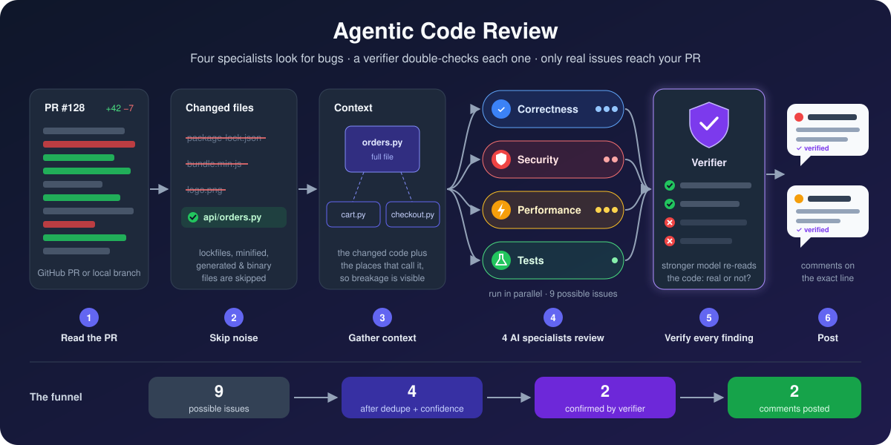
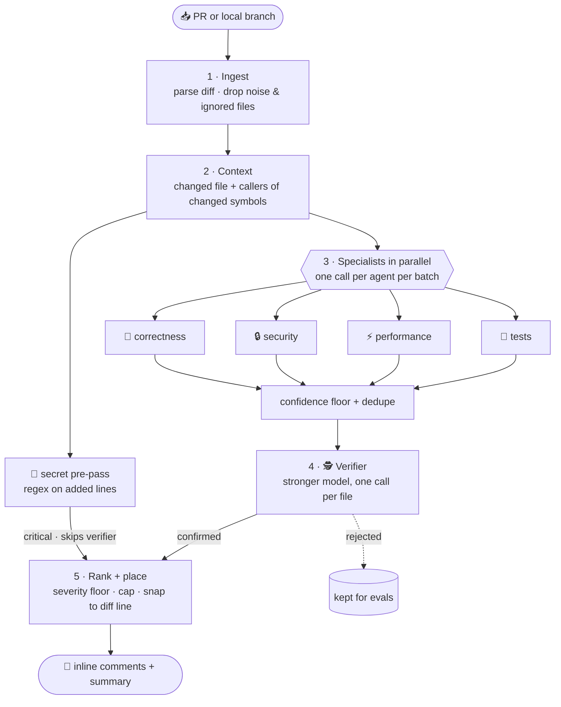

<div align="center">

# 🤖 Agentic Code Review

### A multi-agent pull-request reviewer that would rather say nothing than say something wrong.

Four specialist AI reviewers read your PR in parallel. A stronger **verifier** model re-checks every finding
against the real code. Only what survives gets posted.

[](CHANGELOG.md)
[](pyproject.toml)
[](LICENSE)
[](tests/)
[](https://www.anthropic.com/claude)

[How it works](#how-it-works) ·
[Features](#features) ·
[Quickstart](#quickstart) ·
[Configuration](#configuration) ·
[Deploy](#deploy) ·
[Evals](#evals) ·
[Architecture](#layout) ·
[Changelog](CHANGELOG.md)

<br/>



</div>

---

## 💡 Why this exists

Most AI code reviewers fail the same way: they post **too much**. Ten comments per PR, seven of them
speculative, and within a week the team has muted the bot.

This project makes the opposite bet — **precision over volume**:

| Typical AI reviewer | Agentic Code Review |
|---|---|
| One model, one giant prompt | Four **focused specialists** (correctness, security, performance, tests) |
| Posts whatever the model says | A **second, stronger model verifies** every finding first; no verdict = dropped |
| Style nits and "consider adding a comment" | Prompts forbid nits; every finding must say *what breaks* |
| Comments on random lines (or fails to post) | Findings are **snapped to real diff lines**; off-diff ones go in the summary |
| Unbounded comment count | Severity floor + **hard cap** per PR |
| Reviews lockfiles and minified bundles | **Noise files skipped** before a single token is spent |
| "Trust me, it's good" | A built-in **eval harness** measures precision and recall |

---

<a id="features"></a>

## ✨ Features (v0.1.0)

- **Four parallel specialists** — correctness, security, performance, tests — with forced tool-use output.
- **Verifier pass** on a stronger model; anything it doesn't confirm is dropped (and kept for tuning).
- **Lands on real diff lines** — findings are snapped to commentable lines; severity floor and hard cap per PR.
- **One-click fixes** — single-line fixes post as GitHub ` ```suggestion ` blocks.
- **Per-repo `.acr.yml`** — ignores, severity floor, comment cap, free-text team rules, per-path rules, and
  custom specialists (or built-ins switched off).
- **Skips noise** — lockfiles, minified/generated code, vendored dirs, and binaries never cost a token.
- **Incremental re-reviews** — only new commits are reviewed, and the bot never repeats a comment.
- **Cheap to run** — shared PR context is prompt-cached across specialists; every review reports tokens,
  estimated cost, and latency.
- **Smarter context** — call sites of changed symbols (Python, JS/TS, Go, Java/Kotlin, …) plus optional
  pluggable embedding retrieval.
- **Measurable** — a labelled eval suite for precision/recall, and `acr feedback` for 👍/👎 precision in the wild.
- **Runs anywhere** — CLI, GitHub Action, or a Dockerised webhook service.

See [CHANGELOG.md](CHANGELOG.md) for the full release notes.

---

<a id="how-it-works"></a>

## 🔍 How it works



### Stage 1 — Ingest 📥

The unified diff (from GitHub or `git diff`) is parsed into files and hunks with **new-file line numbers**,
so every finding can point at an exact line. Before anything else happens, files that aren't worth reviewing
are dropped:

- **Noise** — lockfiles (`*.lock`, `package-lock.json`, `pnpm-lock.yaml`, `go.sum`), minified bundles
  (`*.min.js`, `*.min.css`, source maps), generated code (`*_pb2.py`, `*.pb.go`, `*.generated.*`),
  `dist/`, `vendor/`, `node_modules/`, and **binary** diffs.
- **Your ignores** — any globs from the `IGNORE` setting or the repo's `.acr.yml`.

Dropped files are never fetched and never count against the file budget. The number dropped is reported as
`skipped` in the review stats.

### Stage 2 — Context 📚

A diff alone isn't enough to judge a change, so each file gets:

- The **whole file after the change** if it's short (≤ 400 lines), otherwise ±30-line windows around each hunk.
- **Related snippets**: the code finds symbols defined or edited in the diff, searches the repo for other files
  that use them, and includes those call sites. Detection is language-aware for JS/TS (`function`, arrow-function
  `const`s, class methods, `export default function`), Go (`func (r *T) Name`, `type T struct`) and Java/Kotlin
  (methods, constructors, `fun`, classes); other languages fall back to `def`/`class`/`fn`/… patterns. That's how
  the reviewer notices a changed return type that breaks a caller in another file.
- Optionally, **embedding retrieval** (`RETRIEVER=embedding`): the repo is split into 40-line chunks, each chunk
  and each changed file's hunks are embedded, and the closest chunks by cosine similarity are added, so code that
  does the same job under different names still shows up. The embedder is pluggable (any
  `embed(texts) -> list[list[float]]`, passed as `EmbeddingRetriever(embed)` to `build_context`); the built-in
  default is a dependency-free hashed bag-of-identifiers, so it works offline. Local runs index the whole repo
  (up to `EMBEDDING_MAX_FILES`); on GitHub, code-search hits for the changed symbols are re-ranked instead.

Files are then **greedy-packed into batches** that fit `MAX_PROMPT_CHARS`, so big PRs become several calls
instead of one truncated one.

### Stage 3 — Specialists 🧠🔒⚡🧪

Every specialist reviews every batch, **all in parallel**:

| Agent | Looks for |
|---|---|
| 🧠 **correctness** | off-by-ones, wrong conditions, `None` handling, broken invariants, races, breaking API changes |
| 🔒 **security** | injection (SQL / shell / template), auth gaps, secrets in code, unsafe deserialization, path traversal, SSRF |
| ⚡ **performance** | N+1 queries, accidental quadratic loops, unbounded memory/IO, blocking calls in async code |
| 🧪 **tests** | new behaviour or risky branches with no test, tests that assert nothing, tests edited to pass |

Each batch's prompt also carries a short **language-specific pitfalls checklist** for the languages it
contains, detected by extension — Python (async, mutable defaults), JavaScript/TypeScript (floating promises,
`==`), Go (ignored errors, goroutine leaks), Java (nulls, unclosed resources) and SQL (injection in dynamic
queries). The table lives in `agents/languages.py`; set `LANGUAGE_HINTS=false` to leave it out.

Add your own reviewers (or switch built-ins off) with `.acr.yml` [`agents:` / `disable:`](#per-repo-config-acryml).

All agents share the same ground rules: only report problems **introduced or exposed by this change**, cite
the exact line, explain concretely what goes wrong, give an honest confidence score, and treat
*"no findings"* as a perfectly good answer.

Output is collected with **forced tool use** (a JSON schema the model must fill in), so there's no fragile
text parsing. Findings that are malformed or point at files outside the batch are thrown away.

#### 💸 Prompt caching

Four specialists reading the same batch means the same diff, file excerpts, and related snippets are sent
four times. Each specialist call is laid out so that everything shared comes first and is **byte-identical**:

```
tools (report_findings)  →  system (common rules + team rules)  →  [PR context ⟵ cache_control: ephemeral]  →  [specialist focus]
```

Only the short specialist focus differs, and it sits *after* the cache breakpoint. The first specialist on a
batch writes the cache (~1.25× input price for that prefix); the other three read it at ~0.1×. For a typical
batch where the context dominates the prompt, that cuts specialist input cost by roughly 60–65% and also
trims time-to-first-token. To make sure the cache exists before the others ask for it, one specialist runs
first and the rest follow in parallel (`CACHE_WARMUP=false` trades that small latency hit for full
parallelism). Prompts under the model's minimum cacheable length simply aren't cached; nothing breaks.

#### 🔑 Secret scanning pre-pass

Before any model call, every **added** line is checked by deterministic detectors: AWS access key IDs, GitHub
tokens (`ghp_…`, `github_pat_…`), Slack tokens and webhook URLs, Stripe keys, private-key headers, and generic
`password=` / `api_key:` / `secret=` / `token=` assignments whose literal value is long and high-entropy
(placeholders like `${VAR}`, `<API_KEY>` or `changeme` are ignored). A hit becomes a **`critical`** finding in the
`secrets` category with confidence 1.0 that **skips the verifier** — a key format isn't a judgement call. The
value is redacted everywhere it would be shown (`AKIA****************`), including in any agent finding that
quotes it. Silence a known-safe line with `acr: ignore[secrets]`, or turn the pass off with `SECRET_SCAN=false`.

### Stage 4 — Verifier 🕵️

Findings below `MIN_CONFIDENCE` are dropped, and near-duplicates from different agents (same file, within
2 lines, same category or same line) are merged. Everything left goes to the **verifier** — a stronger model with a skeptical
senior-engineer prompt. It sees the code again and returns a verdict for each finding:

- ✅ **confirmed** — real, on the cited line, caused by this PR (it may also adjust the severity)
- ❌ **rejected** — speculative, already handled, style preference, wrong line, or pre-existing

> **A missing verdict counts as a rejection.** That's deliberate: when in doubt, stay quiet.

Rejected findings aren't thrown away. They're kept in `ReviewResult.rejected`, which is exactly the data you
want when tuning prompts.

### Stage 5 — Rank & place 🎯

1. Drop anything below `MIN_SEVERITY`, sort by severity then confidence, keep the top `MAX_COMMENTS`.
2. **Place** each finding: if its line is in the diff it becomes an inline comment; if it's within 3 lines it's
   *snapped* onto the nearest diff line; otherwise it goes into the summary under *"Outside the diff"*.
   (GitHub rejects an **entire** review if a single inline comment targets a line outside the diff, so this
   step matters.)

### What lands on your PR 💬

An inline comment looks like this:

> 🔴 **High · off-by-one** — page is 1-indexed
>
> `page=1` skips the first page of results: the offset is computed as `page * size` instead of `(page - 1) * size`.
>
> **Suggested change:** subtract one before scaling.
>
> ````
> ```suggestion
>     offset = (page - 1) * size
> ```
> ````
>
> <sub>agent: correctness · confidence 90% · verified</sub>

When a one-line edit fixes the issue, the specialist also returns `replacement` — the exact new content of the
cited line — and the comment carries a GitHub ` ```suggestion ` block the author can apply with one click
("Commit suggestion"). The verifier sees the replacement too and rejects the finding if the new line is wrong.
Multi-line replacements, and findings that were *snapped* to a nearby line, fall back to a prose
**Suggested fix:** so a click can never overwrite the wrong line.

…and the summary review shows a severity tally plus the funnel, so you can see the filtering at work:

> 🤖 **Agentic review:** 🔴 1 high · 🟠 1 medium
>
> <sub>9 raw → 4 candidates → 2 verified · 2 rejected by verifier</sub>
>
> <sub>💸 6 calls · 48.2k in (31.0k cached) · 3.4k out · ~$0.21 · 38.4s</sub>

### Re-reviews 🔁

When new commits land on a PR, the reviewer doesn't start from scratch:

- **Only new work is reviewed.** On a `synchronize` event the previous head (`before`) becomes `--since`; only
  the PR hunks that overlap `since...head` go to the agents. If GitHub can't compare the two (the old head was
  force-pushed away), it falls back to a full review rather than skip anything.
- **No repeated comments.** Before verifying, findings on a `(file, line)` the bot already has a live comment on
  are dropped (recognised by the `agent: …` footer), so you never see the same remark twice.
- **Quiet when there's nothing new.** An incremental pass that finds nothing posts nothing.

---

<a id="quickstart"></a>

## 🚀 Quickstart

```bash
git clone https://github.com/Dhillon001/agentic-code-review && cd agentic-code-review
python -m venv .venv && source .venv/bin/activate
pip install -e ".[dev]"
cp .env.example .env          # add ANTHROPIC_API_KEY (+ GITHUB_TOKEN for PRs)

pytest -q                     # runs fully offline — no API key needed
```

### Command line

| Command | What it does |
|---|---|
| `acr local --base main` | Review your current branch against `main` |
| `acr local --repo ../other --base develop --head feature-x` | Review any local repo / refs |
| `acr pr owner/repo 123` | Review a GitHub PR and print the results |
| `acr pr owner/repo 123 --post` | …and post it as a real PR review |
| `acr pr owner/repo 123 --since <sha>` | Incremental: only review hunks changed since `<sha>` |
| `acr feedback owner/repo --days 30` | How useful were the bot's comments? 👍/👎 precision per agent and category |
| `acr local --fail-on high` | CI gate: exit **1** if any posted finding is `high` or worse, **2** if the review itself fails, **0** otherwise (also on `acr pr`) |
| `acr ... --json` | Full machine-readable `ReviewResult` (or `FeedbackReport` for `feedback`) |
| `acr local --format markdown --out review.md` | Markdown report grouped by file (severity icons, ```` ```suggestion ```` blocks, stats + usage footer); `--format text\|json\|markdown\|sarif`, `--json` = `--format json`, `--out` writes to a file instead of stdout (`pr` too) |
| `acr pr owner/repo 123 --format sarif --out acr.sarif` | SARIF 2.1.0 for GitHub code scanning: one rule per category, `error`/`warning`/`note` from severity, line-stable fingerprints, one-line fixes |
| `acr -v ...` | Verbose logging |
| `acr --version` | Print the installed version |

Every run ends with a stats line showing the whole funnel, and a usage line showing what it cost:

```text
stats: {'files': 3, 'skipped': 2, 'batches': 1, 'agent_calls': 4, 'agent_errors': 0,
        'raw_findings': 9, 'already_commented': 0, 'candidates': 4, 'confirmed': 2, 'rejected': 2,
        'posted': 2}
usage: 6 calls · 48.2k in (31.0k cached) · 3.4k out · ~$0.21 · 38.4s
```

| Stat | Meaning |
|---|---|
| `files` / `skipped` | Files reviewed / files dropped as noise or ignored |
| `batches` · `agent_calls` · `agent_errors` | How the work was split, and how many model calls failed (failures never sink the review) |
| `raw_findings` → `candidates` → `confirmed` | The funnel: everything the agents said → after confidence floor + dedupe → after the verifier |
| `already_commented` | Findings dropped because the bot already commented on that exact line in an earlier review |
| `secrets` | Hardcoded credentials found by the regex pre-pass (posted as `critical`, never sent to the verifier) |
| `suppressed` | Findings silenced by an `acr: ignore` comment in the code (see below) |
| `rejected` · `posted` | Killed by the verifier · actually posted after ranking and the cap |

#### 💸 Usage: tokens, cost, latency

Every model call records its input, output, and cache-read/cache-write tokens plus latency; the review totals
them in `ReviewResult.usage` (per model too, under `by_model` in `--json`). The same one-line footer appears in
the CLI, at the bottom of the GitHub summary review, and in the webhook server's log. "in" counts all input
tokens, with the cache hits in brackets, so you can see prompt caching pay off. The dollar figure is an
**estimate** from the `MODEL_PRICES` table (USD per million tokens, matched by model name or prefix; cache reads
default to 0.1× and cache writes to 1.25× the input price). Calls to a model with no price are flagged as
`unpriced` rather than silently counted as free.

#### 👍 Feedback: which agents earn their keep?

Reviewers react to the bot's inline comments with 👍 or 👎. `acr feedback owner/repo [--days 30]` pulls every
inline comment on the repo from that window (`--days 0` = all time), keeps only this bot's (recognised by the
`agent:` footer, which also gives the agent and the category), and prints precision overall, per agent, and per
category:

```text
Feedback on acme/api (last 30 days): 42 comments, 18 rated, precision 78%

agent        comments  rated   👍   👎  precision
correctness        21     10    9    2        80%
security           12      5    4    1        80%
...
```

A comment counts as **useful** when its 👍 outnumber its 👎; precision is useful ÷ rated, where rated means
it got at least one 👍 or 👎. Unrated comments are counted but don't move precision. A low-precision agent or
category is the place to raise the confidence floor or tighten the prompt.

---

<a id="configuration"></a>

## ⚙️ Configuration

### Global settings (environment / `.env`)

| Variable | Default | What it controls |
|---|---|---|
| `ANTHROPIC_API_KEY` | — | Required for any real review |
| `GITHUB_TOKEN` | — | Required for `acr pr` and posting |
| `GITHUB_WEBHOOK_SECRET` | — | Required for the webhook server |
| `REVIEWER_MODEL` | `claude-sonnet-5-5` | Faster model that runs the four specialists |
| `VERIFIER_MODEL` | `claude-opus-5-5` | Stronger model that verifies findings |
| `AGENT_MODELS` | `{}` | Per-specialist model, e.g. `{"security": "claude-opus-5-5", "tests": "claude-haiku-4-5"}`; unlisted agents use `REVIEWER_MODEL` (`.acr.yml` `models:` overrides per name) |
| `LLM_CONCURRENCY` | `4` | Max model calls in flight |
| `CACHE_WARMUP` | `true` | Run one specialist per batch before the others so they hit the prompt cache |
| `MODEL_PRICES` | Opus 5/25 · Sonnet 3/15 · Haiku 1/5 | JSON price table for cost estimates, e.g. `{"claude-opus": {"input": 5, "output": 25}}` (USD per MTok; optional `cache_read` / `cache_write`) |
| `VERIFY` | `true` | Turn the verifier off (useful for evals) |
| `LANGUAGE_HINTS` | `true` | Add a language-specific pitfalls checklist (by file extension) to specialist prompts |
| `SECRET_SCAN` | `true` | Regex pre-pass for hardcoded credentials on added lines |
| `MIN_CONFIDENCE` | `0.5` | Drop agent findings below this before verification |
| `MIN_SEVERITY` | `medium` | `low` · `medium` · `high` · `critical` |
| `MAX_COMMENTS` | `10` | Hard cap on comments per PR |
| `IGNORE` | `[]` | Extra path globs never reviewed (JSON list) |
| `PATH_RULES` | `{}` | Glob → extra rules for matching files only (JSON object; `.acr.yml` `paths:` overrides per glob) |
| `CUSTOM_AGENTS` | `[]` | Extra specialists, e.g. `[{"name": "docs", "focus": "…"}]` (`.acr.yml` `agents:` adds to / overrides by name) |
| `DISABLE_AGENTS` | `[]` | Specialist names to switch off (JSON list; `.acr.yml` `disable:` adds to it) |
| `MAX_FILES` | `50` | Max files reviewed per PR |
| `FULL_FILE_MAX_LINES` | `400` | Send the whole file if it's shorter than this |
| `CONTEXT_LINES` | `30` | Window size around hunks for longer files |
| `MAX_RELATED_PER_FILE` | `3` | Related call-site snippets per file |
| `RETRIEVER` | `lexical` | How related snippets are found: `lexical` (call sites) · `embedding` (similar chunks) |
| `EMBEDDING_CHUNK_LINES` | `40` | Chunk size for embedding retrieval |
| `EMBEDDING_MAX_FILES` | `500` | Max files indexed per review by embedding retrieval |
| `MAX_PROMPT_CHARS` | `120000` | Prompt budget per specialist call (files are batched to fit) |

### Inline suppressions (`acr: ignore`)

Silence a finding right where it lives, in any comment syntax:

```python
legacy_query(sql)       # acr: ignore                    ← nothing on this line
token = os.environ[k]   # acr: ignore[security]          ← only the security agent / category
# acr: ignore-next-line[performance, n-plus-one]
for u in users: db.load(u)                              ← next line, only those
```

A scope token matches an agent name (`security`) or a finding category (`sql-injection`), case-insensitively.
Suppressed findings are dropped **before** the verifier (so they cost nothing to check) and counted as
`suppressed` in the stats. Suppressions are read from the changed file, so they show up in the PR diff for
reviewers to see.

### Per-repo config (`.acr.yml`)

Drop an optional `.acr.yml` in the root of the repo being reviewed. Every key is optional. Values override the
global settings, except `ignore`, which **adds to** the global list.

```yaml
ignore:              # paths never reviewed
  - "docs/**"        # glob on the full path (`*` also crosses `/`)
  - "*.snap"         # no `/` → also matched against the file name
  - "migrations/"    # trailing `/` → that directory anywhere in the tree
min_severity: high   # low | medium | high | critical
max_comments: 5      # cap on comments per PR
rules: |             # team conventions, added to every reviewer's and the verifier's prompt
  - All DB access goes through the repository layer; no raw SQL in request handlers.
paths:               # extra rules only for files matching a glob (same glob syntax as `ignore`)
  "src/api/**": Validate input with pydantic models.
  "*.sql":
    - Every migration is reversible.
    - No SELECT *.
agents:              # extra specialists, run in parallel alongside the built-ins
  - name: accessibility
    focus: Missing alt text, unlabeled form controls, keyboard traps, colour-only cues.
  - name: data-privacy
    focus: PII written to logs, analytics, or third-party calls.
    severity_floor: high   # optional: drop this agent's findings below high
disable: [performance]     # switch off built-in (or custom) specialists
models:                    # per-specialist model; unlisted agents use REVIEWER_MODEL
  security: claude-opus-5-5
  tests: claude-haiku-4-5
```

<details>
<summary><b>How <code>.acr.yml</code> is handled (security & edge cases)</b></summary>

- **For GitHub PRs it's read from the base branch**, so a PR can't switch off or loosen its own review.
  `acr local` is trusted and reads it from the head ref, so you can try changes by committing them.
- `rules` may also be a YAML list of strings. Violations are reported with category `team-rule`. Rules are
  capped at 4,000 characters so they can't eat the prompt budget.
- `paths` rules are injected only into the prompts of file batches that contain a matching file (and into the
  verifier's prompt for that file), labelled with the files they apply to. Each value is a string or list,
  capped like `rules`; at most 50 globs are used. Repo entries override a `PATH_RULES` entry with the same glob.
- `agents` names are 1–40 chars of `a-z 0-9 - _` starting with a letter, and can't reuse a built-in name
  (`correctness`, `security`, `performance`, `tests`) or `secrets`/`verifier` — to replace a built-in, disable
  it and add yours under a new name. Each `focus` is capped at 1,000 characters and at most 8 custom agents are
  used (each one is a model call per batch). An invalid entry is skipped with a warning; the others still run.
  `severity_floor` is that agent's own minimum severity, applied before and after verification. Custom agents
  go through the same verifier, ranking, and `acr: ignore[name]` suppressions as built-ins.
- `disable` takes built-in or custom names; an unknown name is ignored with a warning. Disabling every agent
  leaves only the secret-scanning pre-pass.
- `models` maps a built-in or custom agent name to a model id and overrides an `AGENT_MODELS` entry of the
  same name. The verifier always uses `VERIFIER_MODEL`. A route for an unknown agent, or an invalid model id, is
  ignored with a warning. Usage and estimated cost are tallied per model (`by_model` in `--json`), and prompt
  caching warms once per model, since the cache isn't shared across models.
- **A bad config never blocks a review:** invalid YAML is ignored, and invalid fields fall back to defaults.

</details>

<details>
<summary><b>Built-in noise list</b></summary>

These are always skipped. They live in one list, `NOISE_PATTERNS` in
[`src/reviewer/ingest/noise.py`](src/reviewer/ingest/noise.py); `ignore` extends it.

| Kind | Patterns |
|---|---|
| Lockfiles | `*.lock` (poetry, uv, Cargo, yarn, Gemfile, composer, Pipfile, flake), `*.lockb`, `package-lock.json`, `npm-shrinkwrap.json`, `pnpm-lock.yaml`, `go.sum` |
| Minified / bundled | `*.min.js`, `*.min.css`, `*.js.map`, `*.css.map` |
| Generated code | `*_pb2.py`, `*_pb2_grpc.py`, `*_pb2.pyi`, `*.pb.go`, `*.generated.*` |
| Build output & vendored code | `dist/`, `vendor/`, `node_modules/` |
| Binary | any diff git reports as `Binary files … differ` or `GIT binary patch` |

</details>

---

<a id="deploy"></a>

## 📦 Deploy

<table>
<tr>
<td width="50%" valign="top">

### ⚙️ GitHub Action

Reviews every PR automatically. No server needed.

1. Move [`deploy/code-review.yml`](deploy/code-review.yml) to `.github/workflows/`.
2. Add an `ANTHROPIC_API_KEY` repo secret.
3. Open a PR. 🎉

For **another** repo, copy the workflow and change `pip install .` to
`pip install git+https://github.com/Dhillon001/agentic-code-review`.

To **block merges** on serious findings, add `--fail-on high` to the `acr pr` step and make the check
required. Exit code 2 (review crashed) is distinct from 1 (real findings), so you can tell them apart.
Add `--format markdown --out review.md` and `cat review.md >> "$GITHUB_STEP_SUMMARY"` to get the
report on the workflow run page too.

To get findings as **code-scanning alerts** (Security tab + PR annotations), write SARIF and upload it
(the job needs `permissions: security-events: write`):

```yaml
- run: acr pr ${{ github.repository }} ${{ github.event.pull_request.number }} --format sarif --out acr.sarif
- uses: github/codeql-action/upload-sarif@v3
  if: always()
  with:
    sarif_file: acr.sarif
    category: agentic-code-review
```

Fingerprints hash file + category + title (not the line), so an alert survives code moving above it.

Draft PRs are skipped. On a push, only the new commits are reviewed. A new push cancels the review
that's still running.

</td>
<td width="50%" valign="top">

### 🐳 Webhook service

One service that reviews PRs across many repos.

```bash
docker build -t acr .
docker run -p 8000:8000 --env-file .env acr
```

Then add a GitHub webhook:
**Pull requests** events · JSON · secret = `GITHUB_WEBHOOK_SECRET` · URL = `https://<host>/webhook`.

Signatures are checked with HMAC-SHA256, pushes (`synchronize`) are reviewed incrementally, reviews run
in the background, and `/healthz` is there for your
load balancer.

</td>
</tr>
</table>

---

<a id="evals"></a>

## 📊 Evals: measuring quality

"It feels good" isn't a metric. [`evals/`](evals/) holds labelled PRs: real bugs with their expected lines,
plus **clean** PRs where the right answer is *silence*.

```bash
python evals/run_evals.py               # precision · recall · F1 across all cases
python evals/run_evals.py --no-verify   # same, verifier off: shows what it's worth
python evals/run_evals.py --only sql-injection
```

| Case | What it checks |
|---|---|
| `off-by-one-pagination` | Catches a logic bug in a small diff |
| `sql-injection` | Catches a security bug |
| `race-check-then-act` | Catches a check-then-act race after a lock is removed |
| `path-traversal` | Catches user input joined into a filesystem path |
| `n-plus-one-query` | Catches a query issued per item inside a loop |
| `none-deref-after-changed-return` | Catches a caller dereferencing a function that can now return `None` |
| `untested-branch` | Flags a new branch with no test covering it |
| `clean-refactor` | Says **nothing** on a harmless change (false-positive guard) |
| `clean-any-refactor` | Says **nothing** on a loop rewritten as `any()` |

A finding counts as a hit if it's in the right file within ±3 lines. To add a case, create
`evals/cases/<name>/` with `case.json` (title + expected findings), `change.diff`, and `files/` (the
post-change sources). `pytest` checks that every case loads, that its diff matches `files/`, and that
each expected line is one GitHub would accept an inline comment on.

---

## 🧪 Testing

```bash
pytest -q
```

The whole suite runs **offline in under a second**. A scriptable [`FakeLLM`](tests/conftest.py) stands in for
the model. You tell it which findings each specialist "reports" and which ones the verifier rejects, then
assert on what the pipeline does with them. No API key, no network, no flakiness.

---

<a id="layout"></a>

## 🗂️ Project layout

```text
src/reviewer/
├── ingest/
│   ├── diff.py          # unified-diff parser → files, hunks, new-file line numbers, binary flag
│   ├── noise.py         # NOISE_PATTERNS + split_noise(): what never gets reviewed
│   ├── github.py        # async GitHub REST client
│   └── sources.py       # GitHubSource · LocalGitSource · InMemorySource (read / search files)
├── context/
│   ├── retriever.py     # per-file context · Retriever protocol · lexical call-site retriever
│   └── embedding.py     # EmbeddingRetriever: chunk → embed (pluggable) → cosine top-k
├── agents/
│   ├── prompts.py       # every word the models see + the tool schemas
│   ├── specialists.py   # the four reviewers
│   ├── languages.py     # extension → language pitfalls table (language hints)
│   ├── verifier.py      # second-pass fact checker
│   └── llm.py           # LLM protocol + Anthropic implementation
├── pipeline.py          # orchestration: batch → fan out → dedupe → verify → rank → place
├── ranking.py           # dedupe · severity/cap ranking · snap-to-diff-line
├── secret_scan.py       # regex credential detectors on added lines · redaction
├── suppress.py          # `acr: ignore` directives
├── repo_config.py       # .acr.yml loading, merging, and glob matching
├── usage.py             # per-call token/latency records, price table, cost estimate, usage footer
├── feedback.py          # 👍/👎 reactions on posted comments → precision per agent / category
├── output/
│   ├── github_review.py # comment + summary formatting, posting
│   ├── markdown.py      # --format markdown report
│   └── sarif.py         # --format sarif (GitHub code scanning)
├── service.py           # shared entry points for CLI / server / Action
├── cli.py               # `acr`
├── server.py            # FastAPI webhook
├── config.py            # Settings (env / .env)
└── models.py            # pydantic models: FileDiff, Finding, ReviewResult, …
evals/                   # labelled cases + precision/recall scorer
tests/                   # offline tests with FakeLLM
deploy/                  # GitHub Action workflow
```

---

## 🧭 Design choices

- **🔧 Forced tool use for all model output.** Structured JSON every time, no regex parsing.
- **🔢 Line-numbered diffs in every prompt.** Models cite real line numbers instead of guessing.
- **🤐 Missing verdict = rejected.** Conservative on purpose. A wrong comment costs more than a missed one.
- **⚖️ Cheap model fans out, strong model verifies.** Parallel breadth from the fast model, judgement from the
  expensive one, only on the few findings that matter.
- **🧯 Failures are contained.** If one specialist call fails, it's logged and counted in `agent_errors`; the rest
  of the review still posts.
- **🗃️ Rejected findings are kept.** They're your training signal for prompt tuning.
- **🔌 Everything goes through an `LLM` protocol.** Swap providers, or a fake for tests, without touching the
  pipeline.

---

## 🗺️ Roadmap

**v0.1.0 is released; v0.2.0 (CI gating, SARIF, secret scanning, budgets, eval tooling) is in progress** — one tested feature per commit. Full detail in [ROADMAP.md](ROADMAP.md); release notes
in [CHANGELOG.md](CHANGELOG.md).

- [x] Per-repo config (`.acr.yml`)
- [x] Skip noise files
- [x] Incremental re-review (only new commits, no duplicate comments)
- [x] Prompt caching for the shared PR context
- [x] Token, cost, and latency tracking
- [x] More eval cases
- [x] One-click GitHub ` ```suggestion ` blocks
- [x] 👍/👎 feedback report: precision per agent
- [x] Pluggable embedding retrieval
- [x] Better symbol detection for JS/TS, Go, Java/Kotlin
- [x] Release v0.1.0

---

<div align="center">

MIT © 2026 Harsharandeep Dhillon · Built with [Claude](https://www.anthropic.com/claude)

<sub>If this reviewer ever posts a comment you think is wrong, that's a bug. Please open an issue with the PR link.</sub>

</div>
