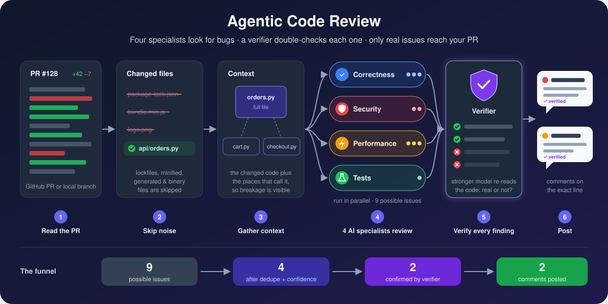
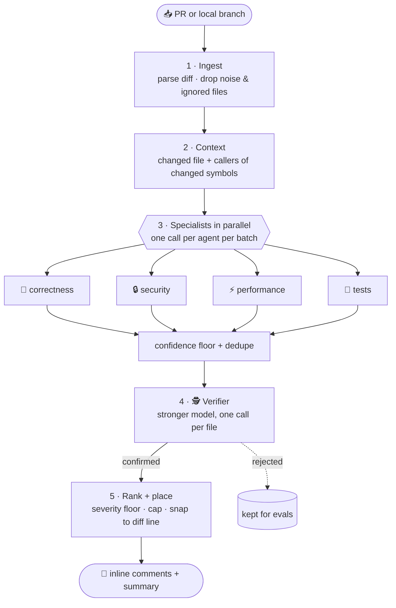

<div align="center">

# 🤖 Agentic Code Review

### A multi-agent pull-request reviewer that would rather say nothing than say something wrong.

Four specialist AI reviewers read your PR in parallel. A stronger **verifier** model re-checks every finding
against the real code. Only what survives gets posted.

[](pyproject.toml)
[](LICENSE)
[](tests/)
[](https://www.anthropic.com/claude)
[](ROADMAP.md)

[How it works](#how-it-works) ·
[Quickstart](#quickstart) ·
[Configuration](#configuration) ·
[Deploy](#deploy) ·
[Evals](#evals) ·
[Architecture](#layout)

<br/>



</div>

---

## 💡 Why this exists

Most AI code reviewers fail the same way: they post **too much**. Ten comments per PR, seven of them
speculative, and within a week the team has muted the bot.

This project makes the opposite bet — **precision over volume**:

| Typical AI reviewer | Agentic Code Review |
|---|---|
| One model, one giant prompt | Four **focused specialists** (correctness, security, performance, tests) |
| Posts whatever the model says | A **second, stronger model verifies** every finding first; no verdict = dropped |
| Style nits and "consider adding a comment" | Prompts forbid nits; every finding must say *what breaks* |
| Comments on random lines (or fails to post) | Findings are **snapped to real diff lines**; off-diff ones go in the summary |
| Unbounded comment count | Severity floor + **hard cap** per PR |
| Reviews lockfiles and minified bundles | **Noise files skipped** before a single token is spent |
| "Trust me, it's good" | A built-in **eval harness** measures precision and recall |

---

<a id="how-it-works"></a>

## 🔍 How it works



### Stage 1 — Ingest 📥

The unified diff (from GitHub or `git diff`) is parsed into files and hunks with **new-file line numbers**,
so every finding can point at an exact line. Before anything else happens, files that aren't worth reviewing
are dropped:

- **Noise** — lockfiles (`*.lock`, `package-lock.json`, `pnpm-lock.yaml`, `go.sum`), minified bundles
  (`*.min.js`, `*.min.css`, source maps), generated code (`*_pb2.py`, `*.pb.go`, `*.generated.*`),
  `dist/`, `vendor/`, `node_modules/`, and **binary** diffs.
- **Your ignores** — any globs from the `IGNORE` setting or the repo's `.acr.yml`.

Dropped files are never fetched and never count against the file budget. The number dropped is reported as
`skipped` in the review stats.

### Stage 2 — Context 📚

A diff alone isn't enough to judge a change, so each file gets:

- The **whole file after the change** if it's short (≤ 400 lines), otherwise ±30-line windows around each hunk.
- **Related snippets**: the code finds symbols defined or edited in the diff (`def`, `class`, `func`, …), searches
  the repo for other files that use them, and includes those call sites. That's how the reviewer notices a
  changed return type that breaks a caller in another file.

Files are then **greedy-packed into batches** that fit `MAX_PROMPT_CHARS`, so big PRs become several calls
instead of one truncated one.

### Stage 3 — Specialists 🧠🔒⚡🧪

Every specialist reviews every batch, **all in parallel**:

| Agent | Looks for |
|---|---|
| 🧠 **correctness** | off-by-ones, wrong conditions, `None` handling, broken invariants, races, breaking API changes |
| 🔒 **security** | injection (SQL / shell / template), auth gaps, secrets in code, unsafe deserialization, path traversal, SSRF |
| ⚡ **performance** | N+1 queries, accidental quadratic loops, unbounded memory/IO, blocking calls in async code |
| 🧪 **tests** | new behaviour or risky branches with no test, tests that assert nothing, tests edited to pass |

All agents share the same ground rules: only report problems **introduced or exposed by this change**, cite
the exact line, explain concretely what goes wrong, give an honest confidence score, and treat
*"no findings"* as a perfectly good answer.

Output is collected with **forced tool use** (a JSON schema the model must fill in), so there's no fragile
text parsing. Findings that are malformed or point at files outside the batch are thrown away.

#### 💸 Prompt caching

Four specialists reading the same batch means the same diff, file excerpts, and related snippets are sent
four times. Each specialist call is laid out so that everything shared comes first and is **byte-identical**:

```
tools (report_findings)  →  system (common rules + team rules)  →  [PR context ⟵ cache_control: ephemeral]  →  [specialist focus]
```

Only the short specialist focus differs, and it sits *after* the cache breakpoint. The first specialist on a
batch writes the cache (~1.25× input price for that prefix); the other three read it at ~0.1×. For a typical
batch where the context dominates the prompt, that cuts specialist input cost by roughly 60–65% and also
trims time-to-first-token. To make sure the cache exists before the others ask for it, one specialist runs
first and the rest follow in parallel (`CACHE_WARMUP=false` trades that small latency hit for full
parallelism). Prompts under the model's minimum cacheable length simply aren't cached; nothing breaks.

### Stage 4 — Verifier 🕵️

Findings below `MIN_CONFIDENCE` are dropped, and near-duplicates from different agents (same file, within
2 lines, same category or same line) are merged. Everything left goes to the **verifier** — a stronger model with a skeptical
senior-engineer prompt. It sees the code again and returns a verdict for each finding:

- ✅ **confirmed** — real, on the cited line, caused by this PR (it may also adjust the severity)
- ❌ **rejected** — speculative, already handled, style preference, wrong line, or pre-existing

> **A missing verdict counts as a rejection.** That's deliberate: when in doubt, stay quiet.

Rejected findings aren't thrown away. They're kept in `ReviewResult.rejected`, which is exactly the data you
want when tuning prompts.

### Stage 5 — Rank & place 🎯

1. Drop anything below `MIN_SEVERITY`, sort by severity then confidence, keep the top `MAX_COMMENTS`.
2. **Place** each finding: if its line is in the diff it becomes an inline comment; if it's within 3 lines it's
   *snapped* onto the nearest diff line; otherwise it goes into the summary under *"Outside the diff"*.
   (GitHub rejects an **entire** review if a single inline comment targets a line outside the diff, so this
   step matters.)

### What lands on your PR 💬

An inline comment looks like this:

> 🔴 **High · off-by-one** — page is 1-indexed
>
> `page=1` skips the first page of results: the offset is computed as `page * size` instead of `(page - 1) * size`.
>
> **Suggested fix:** use `(page - 1) * size`.
>
> <sub>agent: correctness · confidence 90% · verified</sub>

…and the summary review shows a severity tally plus the funnel, so you can see the filtering at work:

> 🤖 **Agentic review:** 🔴 1 high · 🟠 1 medium
>
> <sub>9 raw → 4 candidates → 2 verified · 2 rejected by verifier</sub>

### Re-reviews 🔁

When new commits land on a PR, the reviewer doesn't start from scratch:

- **Only new work is reviewed.** On a `synchronize` event the previous head (`before`) becomes `--since`; only
  the PR hunks that overlap `since...head` go to the agents. If GitHub can't compare the two (the old head was
  force-pushed away), it falls back to a full review rather than skip anything.
- **No repeated comments.** Before verifying, findings on a `(file, line)` the bot already has a live comment on
  are dropped (recognised by the `agent: …` footer), so you never see the same remark twice.
- **Quiet when there's nothing new.** An incremental pass that finds nothing posts nothing.

---

<a id="quickstart"></a>

## 🚀 Quickstart

```bash
git clone https://github.com/Dhillon001/agentic-code-review && cd agentic-code-review
python -m venv .venv && source .venv/bin/activate
pip install -e ".[dev]"
cp .env.example .env          # add ANTHROPIC_API_KEY (+ GITHUB_TOKEN for PRs)

pytest -q                     # runs fully offline — no API key needed
```

### Command line

| Command | What it does |
|---|---|
| `acr local --base main` | Review your current branch against `main` |
| `acr local --repo ../other --base develop --head feature-x` | Review any local repo / refs |
| `acr pr owner/repo 123` | Review a GitHub PR and print the results |
| `acr pr owner/repo 123 --post` | …and post it as a real PR review |
| `acr pr owner/repo 123 --since <sha>` | Incremental: only review hunks changed since `<sha>` |
| `acr ... --json` | Full machine-readable `ReviewResult` |
| `acr -v ...` | Verbose logging |

Every run ends with a stats line showing the whole funnel:

```text
stats: {'files': 3, 'skipped': 2, 'batches': 1, 'agent_calls': 4, 'agent_errors': 0,
        'raw_findings': 9, 'already_commented': 0, 'candidates': 4, 'confirmed': 2, 'rejected': 2,
        'posted': 2}
```

| Stat | Meaning |
|---|---|
| `files` / `skipped` | Files reviewed / files dropped as noise or ignored |
| `batches` · `agent_calls` · `agent_errors` | How the work was split, and how many model calls failed (failures never sink the review) |
| `raw_findings` → `candidates` → `confirmed` | The funnel: everything the agents said → after confidence floor + dedupe → after the verifier |
| `already_commented` | Findings dropped because the bot already commented on that exact line in an earlier review |
| `rejected` · `posted` | Killed by the verifier · actually posted after ranking and the cap |

---

<a id="configuration"></a>

## ⚙️ Configuration

### Global settings (environment / `.env`)

| Variable | Default | What it controls |
|---|---|---|
| `ANTHROPIC_API_KEY` | — | Required for any real review |
| `GITHUB_TOKEN` | — | Required for `acr pr` and posting |
| `GITHUB_WEBHOOK_SECRET` | — | Required for the webhook server |
| `REVIEWER_MODEL` | `claude-sonnet-5-5` | Faster model that runs the four specialists |
| `VERIFIER_MODEL` | `claude-opus-5-5` | Stronger model that verifies findings |
| `LLM_CONCURRENCY` | `4` | Max model calls in flight |
| `CACHE_WARMUP` | `true` | Run one specialist per batch before the others so they hit the prompt cache |
| `VERIFY` | `true` | Turn the verifier off (useful for evals) |
| `MIN_CONFIDENCE` | `0.5` | Drop agent findings below this before verification |
| `MIN_SEVERITY` | `medium` | `low` · `medium` · `high` · `critical` |
| `MAX_COMMENTS` | `10` | Hard cap on comments per PR |
| `IGNORE` | `[]` | Extra path globs never reviewed (JSON list) |
| `MAX_FILES` | `50` | Max files reviewed per PR |
| `FULL_FILE_MAX_LINES` | `400` | Send the whole file if it's shorter than this |
| `CONTEXT_LINES` | `30` | Window size around hunks for longer files |
| `MAX_RELATED_PER_FILE` | `3` | Related call-site snippets per file |
| `MAX_PROMPT_CHARS` | `120000` | Prompt budget per specialist call (files are batched to fit) |

### Per-repo config (`.acr.yml`)

Drop an optional `.acr.yml` in the root of the repo being reviewed. Every key is optional. Values override the
global settings, except `ignore`, which **adds to** the global list.

```yaml
ignore:              # paths never reviewed
  - "docs/**"        # glob on the full path (`*` also crosses `/`)
  - "*.snap"         # no `/` → also matched against the file name
  - "migrations/"    # trailing `/` → that directory anywhere in the tree
min_severity: high   # low | medium | high | critical
max_comments: 5      # cap on comments per PR
rules: |             # team conventions, added to every reviewer's and the verifier's prompt
  - All DB access goes through the repository layer; no raw SQL in request handlers.
  - Public functions in api/ validate input with pydantic models.
```

<details>
<summary><b>How <code>.acr.yml</code> is handled (security & edge cases)</b></summary>

- **For GitHub PRs it's read from the base branch**, so a PR can't switch off or loosen its own review.
  `acr local` is trusted and reads it from the head ref, so you can try changes by committing them.
- `rules` may also be a YAML list of strings. Violations are reported with category `team-rule`. Rules are
  capped at 4,000 characters so they can't eat the prompt budget.
- **A bad config never blocks a review:** invalid YAML is ignored, and invalid fields fall back to defaults.

</details>

<details>
<summary><b>Built-in noise list</b></summary>

These are always skipped. They live in one list, `NOISE_PATTERNS` in
[`src/reviewer/ingest/noise.py`](src/reviewer/ingest/noise.py); `ignore` extends it.

| Kind | Patterns |
|---|---|
| Lockfiles | `*.lock` (poetry, uv, Cargo, yarn, Gemfile, composer, Pipfile, flake), `*.lockb`, `package-lock.json`, `npm-shrinkwrap.json`, `pnpm-lock.yaml`, `go.sum` |
| Minified / bundled | `*.min.js`, `*.min.css`, `*.js.map`, `*.css.map` |
| Generated code | `*_pb2.py`, `*_pb2_grpc.py`, `*_pb2.pyi`, `*.pb.go`, `*.generated.*` |
| Build output & vendored code | `dist/`, `vendor/`, `node_modules/` |
| Binary | any diff git reports as `Binary files … differ` or `GIT binary patch` |

</details>

---

<a id="deploy"></a>

## 📦 Deploy

<table>
<tr>
<td width="50%" valign="top">

### ⚙️ GitHub Action

Reviews every PR automatically. No server needed.

1. Move [`deploy/code-review.yml`](deploy/code-review.yml) to `.github/workflows/`.
2. Add an `ANTHROPIC_API_KEY` repo secret.
3. Open a PR. 🎉

For **another** repo, copy the workflow and change `pip install .` to
`pip install git+https://github.com/Dhillon001/agentic-code-review`.

Draft PRs are skipped. On a push, only the new commits are reviewed. A new push cancels the review
that's still running.

</td>
<td width="50%" valign="top">

### 🐳 Webhook service

One service that reviews PRs across many repos.

```bash
docker build -t acr .
docker run -p 8000:8000 --env-file .env acr
```

Then add a GitHub webhook:
**Pull requests** events · JSON · secret = `GITHUB_WEBHOOK_SECRET` · URL = `https://<host>/webhook`.

Signatures are checked with HMAC-SHA256, pushes (`synchronize`) are reviewed incrementally, reviews run
in the background, and `/healthz` is there for your
load balancer.

</td>
</tr>
</table>

---

<a id="evals"></a>

## 📊 Evals: measuring quality

"It feels good" isn't a metric. [`evals/`](evals/) holds labelled PRs: real bugs with their expected lines,
plus **clean** PRs where the right answer is *silence*.

```bash
python evals/run_evals.py               # precision · recall · F1 across all cases
python evals/run_evals.py --no-verify   # same, verifier off: shows what it's worth
python evals/run_evals.py --only sql-injection
```

| Case | What it checks |
|---|---|
| `off-by-one-pagination` | Catches a logic bug in a small diff |
| `sql-injection` | Catches a security bug |
| `clean-refactor` | Says **nothing** on a harmless change (false-positive guard) |

A finding counts as a hit if it's in the right file within ±3 lines. To add a case, create
`evals/cases/<name>/` with `case.json` (title + expected findings), `change.diff`, and `files/` (the
post-change sources).

---

## 🧪 Testing

```bash
pytest -q
```

The whole suite runs **offline in under a second**. A scriptable [`FakeLLM`](tests/conftest.py) stands in for
the model. You tell it which findings each specialist "reports" and which ones the verifier rejects, then
assert on what the pipeline does with them. No API key, no network, no flakiness.

---

<a id="layout"></a>

## 🗂️ Project layout

```text
src/reviewer/
├── ingest/
│   ├── diff.py          # unified-diff parser → files, hunks, new-file line numbers, binary flag
│   ├── noise.py         # NOISE_PATTERNS + split_noise(): what never gets reviewed
│   ├── github.py        # async GitHub REST client
│   └── sources.py       # GitHubSource · LocalGitSource · InMemorySource (read / search files)
├── context/
│   └── retriever.py     # per-file context + related call sites (the seam for embedding RAG)
├── agents/
│   ├── prompts.py       # every word the models see + the tool schemas
│   ├── specialists.py   # the four reviewers
│   ├── verifier.py      # second-pass fact checker
│   └── llm.py           # LLM protocol + Anthropic implementation
├── pipeline.py          # orchestration: batch → fan out → dedupe → verify → rank → place
├── ranking.py           # dedupe · severity/cap ranking · snap-to-diff-line
├── repo_config.py       # .acr.yml loading, merging, and glob matching
├── output/
│   └── github_review.py # comment + summary formatting, posting
├── service.py           # shared entry points for CLI / server / Action
├── cli.py               # `acr`
├── server.py            # FastAPI webhook
├── config.py            # Settings (env / .env)
└── models.py            # pydantic models: FileDiff, Finding, ReviewResult, …
evals/                   # labelled cases + precision/recall scorer
tests/                   # offline tests with FakeLLM
deploy/                  # GitHub Action workflow
```

---

## 🧭 Design choices

- **🔧 Forced tool use for all model output.** Structured JSON every time, no regex parsing.
- **🔢 Line-numbered diffs in every prompt.** Models cite real line numbers instead of guessing.
- **🤐 Missing verdict = rejected.** Conservative on purpose. A wrong comment costs more than a missed one.
- **⚖️ Cheap model fans out, strong model verifies.** Parallel breadth from the fast model, judgement from the
  expensive one, only on the few findings that matter.
- **🧯 Failures are contained.** If one specialist call fails, it's logged and counted in `agent_errors`; the rest
  of the review still posts.
- **🗃️ Rejected findings are kept.** They're your training signal for prompt tuning.
- **🔌 Everything goes through an `LLM` protocol.** Swap providers, or a fake for tests, without touching the
  pipeline.

---

## 🗺️ Roadmap

Toward **v0.1.0**, one tested feature per commit. Full detail in [ROADMAP.md](ROADMAP.md).

- [x] Per-repo config (`.acr.yml`)
- [x] Skip noise files
- [x] Incremental re-review (only new commits, no duplicate comments)
- [x] Prompt caching for the shared PR context
- [ ] Token, cost, and latency tracking
- [ ] More eval cases
- [ ] One-click GitHub ` ```suggestion ` blocks
- [ ] 👍/👎 feedback report: precision per agent
- [ ] Pluggable embedding retrieval
- [ ] Better symbol detection for JS/TS, Go, Java/Kotlin

---

<div align="center">

MIT © 2026 Harsharandeep Dhillon · Built with [Claude](https://www.anthropic.com/claude)

<sub>If this reviewer ever posts a comment you think is wrong, that's a bug. Please open an issue with the PR link.</sub>

</div>
